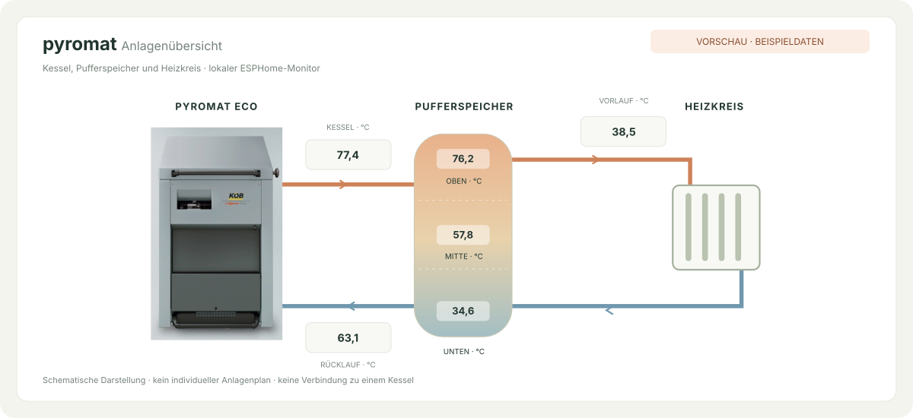

# Pyromat ESPHome

**Dein Heizraum im Browser.** Ein lokaler Anlagenmonitor für den Köb Pyromat Eco mit Ecotronic-Regelung: ESP32 und MCP2515 empfangen die CAN-Telegramme, ESPHome stellt die Werte im Web, über seine native API und optional per MQTT bereit.

[](https://github.com/landvogt78/Pyromat-ESPHome/actions/workflows/validate.yml)




*Schematische Vorschau mit Beispieldaten. Die tatsächliche Weboberfläche ergänzt Messwertkarten, alle Werte, Diagnose und einen Hell-/Dunkelmodus.*

[Einrichtung](#einrichtung) · [Hardware](#hardware) · [Home Assistant & MQTT](#anbindungen) · [CAN-Zuordnungen](docs/protokoll.md) · [Mitmachen](CONTRIBUTING.md)

## Was du bekommst

- Eine responsive, deutschsprachige Weboberfläche mit Kessel, Pufferspeicher und Heizkreis als Hydraulikschema.
- Kessel-, Abgas-, Rücklauf-, System-, Heizungs- und Puffertemperaturen, Restsauerstoff, Lüfterdrehzahl und Luftklappen.
- Kesseluhr, Datum, CAN-Empfang, Telegrammzähler, Datenalter und Netzwerkdiagnose.
- Sichtbar als solche gekennzeichnete Rohwerte und ein noch zu bestätigender Sauerstoff-Sollwert.
- Neustart des **ESP32** über die Oberfläche, mit Bestätigung. Der Heizkessel wird dadurch nicht neu gestartet.
- Verschlüsselte native ESPHome-API und verschlüsselte ESPHome-OTA-Updates, optional zusätzlich MQTT.
- Einen zugangsgeschützten Webserver, WLAN-Einrichtung bei Verbindungsproblemen und ein Hilfsprogramm für lokale Zugangsdaten.

Die Oberfläche und ihre Schrift-/Grafikelemente liegen im Flash. Für den Betrieb sind kein externer Webserver, keine Cloud und keine nachgeladenen Schriftarten oder JavaScript-Bibliotheken nötig. Das Hydraulikbild ist eine vereinfachte Darstellung, kein individueller Anlagenplan. Eine Pumpenaktivität oder ein Pufferfüllstand wird daraus nicht erfunden.

## Kompatibilität

Die Konfiguration entstand für einen **Köb Pyromat Eco mit Ecotronic** und verwendet MCP2515 bei 125 kbit/s. Die Zuordnungen wurden mit einer Aufzeichnung des Projektkessels vom 30.10.2024 abgeglichen. Die Regelungsversion ist dabei nicht dokumentiert; eine Übereinstimmung bei jedem Ecotronic-Stand kann deshalb nicht zugesagt werden.

Ausgewertet werden die IDs `0x23B`, `0x33B`, `0x43B` und `0x53B`. Entscheidend ist zusätzlich der vollständige 16-Bit-Index im Telegramm. **Für den Vitoligno 300-C ist die Zuordnung noch nicht bestätigt.** Gleiche CAN-IDs bedeuten keine identische Registerbelegung. Andere aus dem Forum bekannte Varianten, etwa `0x381`, werden nicht automatisch gleichgesetzt. Details und offene Felder stehen in der [Protokolldokumentation](docs/protokoll.md).

## Einrichtung

### 1. Projekt und ESPHome installieren

Das vollständige Repository wird benötigt, einschließlich `packages/`, `include/` und `web/`. Python 3.12 oder neuer und ESPHome **2026.9.1** verwenden; diese Version ist in `requirements.txt` festgelegt. Eine virtuelle Python-Umgebung ist empfehlenswert.

```sh
git clone https://github.com/landvogt78/Pyromat-ESPHome.git
cd Pyromat-ESPHome
python -m pip install -r requirements.txt
python tools/setup_secrets.py
```

Das letzte Kommando erzeugt eine **lokale, von Git ausgeschlossene `secrets.yaml`** mit zufälligem API-/OTA-Schlüssel und getrennten Passwörtern für Weboberfläche und Einrichtungs-WLAN. Eine vorhandene Datei wird niemals überschrieben. Der Schlüssel ist ein Base64-kodierter 32-Byte-Schlüssel; keine selbst ausgedachte Zeichenfolge einsetzen.

### 2. Zugangsdaten eintragen

In `secrets.yaml` mindestens diese Angaben anpassen:

| Schlüssel | Verwendung |
| --- | --- |
| `my_wifi_ssid`, `my_wifi_password` | Dein WLAN |
| `web_server_username`, `web_server_password` | Anmeldung an der Weboberfläche |
| `api_encryption_key` | Gemeinsamer Schlüssel für native API und verschlüsselte OTA-Updates |
| `fallback_ap_password` | Passwort des Einrichtungs-WLANs |
| `mqtt_broker`, `mqtt_port` | MQTT-Server und Port, nur für die MQTT-Variante |
| `mqtt_username`, `mqtt_password`, `mqtt_topic_prefix` | MQTT-Anmeldung und Themen-Präfix |

[`secrets.example.yaml`](secrets.example.yaml) dokumentiert die Struktur. Sie enthält Platzhalter und kann nicht unverändert als fertige Konfiguration verwendet werden. Echte WLAN-Passwörter, API-Schlüssel und komplette CAN-Aufzeichnungen gehören nicht in GitHub.

### 3. Variante wählen

| Datei | Enthalten |
| --- | --- |
| **`pyromat.yaml`** | Weboberfläche + native API + MQTT; passend z. B. für ioBroker |
| **`pyromat-api.yaml`** | Weboberfläche + native API; ohne MQTT-Abhängigkeit |

Auch bei der MQTT-Variante bleibt die API aktiv. Ohne verbundenen API-Client oder MQTT-Broker wird kein automatischer Neustart ausgelöst. Wenn Home Assistant beide Integrationen empfängt, können doppelte Entitäten entstehen; dort eine der beiden Anbindungen nutzen.

### 4. Prüfen und installieren

```sh
esphome config pyromat.yaml
esphome compile pyromat.yaml
esphome run pyromat.yaml --device COM5
```

`COM5` durch den tatsächlichen USB-Port ersetzen, unter Linux beispielsweise `/dev/ttyUSB0`. Für die Variante ohne MQTT in allen Befehlen `pyromat-api.yaml` verwenden. Die Erstinstallation erfolgt über USB. Danach sind verschlüsselte OTA-Updates mit derselben lokalen `secrets.yaml` möglich:

```sh
esphome run pyromat.yaml --device pyromat.local
```

Die passende Variante immer beibehalten, damit eine spätere Installation nicht versehentlich MQTT entfernt oder hinzufügt. Die geprüfte Konfiguration verwendet das ESP-IDF-Framework.

### 5. Oberfläche öffnen

Im eigenen Netzwerk **[http://pyromat.local](http://pyromat.local)** aufrufen und mit den Web-Zugangsdaten anmelden. Falls der Name nicht aufgelöst wird, die IP-Adresse aus dem Router verwenden. Funktioniert das konfigurierte WLAN nicht, stellt ESPHome das passwortgeschützte Netz **„Pyromat Einrichtung“** mit Einrichtungsportal bereit.

Die Oberfläche zeigt fehlende Werte als `—`. Nach 30 Sekunden ohne CAN-Telegramm werden CAN-Werte als veraltet markiert; ein einzelner Messwert läuft nach 60 Sekunden ohne gültige Aktualisierung ab. Ein abgerissenes Browser-Ereignisabonnement wird ebenfalls angezeigt. Gleichbleibende Temperaturen bleiben aktuell, solange sie weiter empfangen werden.

## Hardware

Vorgesehen sind ein **ESP32 DevKit (`esp32dev`)** und ein **MCP2515-Modul mit passendem CAN-Transceiver**, standardmäßig mit **8-MHz-Quarz**.

| ESP32 | MCP2515 / Anschluss |
| --- | --- |
| GPIO18 | SCK |
| GPIO23 | SI / MOSI |
| GPIO19 | SO / MISO |
| GPIO5 | CS |
| GND | Gemeinsame Masse gemäß Anlagenbeschaltung |
| CAN-Seite des Transceivers | CAN-H und CAN-L der Regelung |

Der INT-Pin wird von dieser Konfiguration nicht verwendet. Versorgung und Logikpegel hängen vom Modul ab: **ESP32-GPIOs sind nicht 5-V-tolerant.** Insbesondere günstige MCP2515-/TJA1050-Module vor dem Anschluss prüfen und gegebenenfalls Pegelanpassung bzw. ein geeignetes Modul verwenden. Eine 24-V-Anlagenversorgung benötigt einen geeigneten Spannungswandler; nicht direkt am ESP32 anschließen. Am Heizgerät nur an der dokumentierten Schnittstelle arbeiten.

Der CAN-Bus wird an seinen beiden Enden terminiert. Ein zusätzlicher Teilnehmer in der Mitte bekommt keinen weiteren Abschlusswiderstand. GPIO5 ist beim ESP32 ein Strapping-Pin; die entsprechende ESPHome-Warnung ist bei der bisherigen Belegung zu erwarten. Wenn die Beschaltung den Start beeinflusst, einen geeigneten anderen CS-Pin wählen und umverdrahten.

Abweichende Pins, Gerätebezeichnung oder einen tatsächlich vorhandenen 16-MHz-Quarz über `substitutions` in der gewählten Hauptdatei einstellen, beispielsweise vor `packages:`:

```yaml
substitutions:
  device_name: pyromat
  friendly_name: Pyromat Eco
  mcp2515_cs_pin: "5"
  mcp2515_clock: 8MHz
```

Weitere Vorgaben stehen am Anfang von [`packages/bridge.yaml`](packages/bridge.yaml). Die Quarzfrequenz muss zur Hardware passen. Standard ist `can_mode: NORMAL`: Die Anwendung sendet keine Steuertelegramme, der CAN-Controller bestätigt empfangene gültige Frames jedoch auf Hardwareebene. `LISTENONLY` ist möglich, wenn andere Teilnehmer die notwendigen CAN-Bestätigungen übernehmen.

## Anbindungen

**Home Assistant:** ESPHome-Integration hinzufügen, `pyromat.local` bzw. die IP-Adresse und den Schlüssel aus `api_encryption_key` verwenden. Der API-Port ist standardmäßig `6053`. Sensoren und Neustarttaste werden von ESPHome bereitgestellt.

**ioBroker / MQTT:** Die Broker-Zugangsdaten in `secrets.yaml` setzen und `pyromat.yaml` installieren. ESPHome veröffentlicht unter `mqtt_topic_prefix`, standardmäßig `pyromat`. MQTT-Discovery ist aktiviert. Die Beispielverbindung auf Port `1883` ist unverschlüsselt und für ein vertrauenswürdiges lokales Netz gedacht.

**Lokaler HTTP-Zugriff:** Die ESPHome-Webserver-Endpunkte bleiben verfügbar, beispielsweise:

```sh
curl --digest -u admin http://pyromat.local/sensor/Kesseltemperatur
```

`curl` fragt das Passwort ab. Der Neustart erfolgt durch `POST /button/ESP%20neu%20starten/press`; die Weboberfläche fragt vorher nach. Web-Anmeldung verwendet HTTP Digest. Der Webserver bietet hier kein HTTPS; Zugang nur im eigenen Netz oder über ein VPN, keine direkte Portfreigabe ins Internet. OTA über den Webserver ist ausgeschaltet; Updates erfolgen über ESPHome.

## Umstieg von der bisherigen YAML

Vorherige Konfiguration und Zugangsdaten sichern. Die neue Fassung besteht aus mehreren Dateien; alle gemeinsam übernehmen. Eine vorhandene `secrets.yaml` bleibt erhalten. Bei Bedarf mit `python tools/setup_secrets.py --output secrets.generated.yaml` neue zufällige Angaben erzeugen und die API-/OTA-, Web- und Einrichtungs-WLAN-Einträge in die vorhandene Datei übernehmen. Die erzeugte Zusatzdatei ist ebenfalls von Git ausgeschlossen.

Die internen IDs der bisherigen Messwerte bleiben erhalten. Sichtbare Namen wurden bereinigt und numerische Präfixe entfernt; dadurch können sich Entitätsnamen bzw. MQTT-Themen ändern. In Home Assistant, ioBroker und bestehenden Grafiken die Zuordnung nach dem Update prüfen. Ventilwerte tragen jetzt ausdrücklich **„Rohwert“** und keine unbestätigte Prozent-Einheit. Diese Fassung ergänzt die bisher drei ausgewerteten CAN-IDs um `0x43B` und verarbeitet damit alle vier IDs der Aufzeichnung.

## Vorschau und Entwicklung

Die Oberfläche lässt sich ohne ESP32 ansehen:

```sh
python -m http.server 8000 --bind 127.0.0.1 --directory web
```

Danach `http://127.0.0.1:8000/preview.html` öffnen. Ein Banner kennzeichnet die Beispieldaten. Die Vorschau zeigt auch fehlende Daten und Verbindungsausfall; ihre Neustarttaste sendet keinen Befehl.

```sh
node --test tests/dashboard.test.cjs
python -m unittest discover -s tests -p "test_*.py"
g++ -std=c++17 tests/decoder_test.cpp -o decoder-test
./decoder-test
```

Unter Windows kann ein anderer C++17-Compiler verwendet werden. Die [GitHub-Prüfung](.github/workflows/validate.yml) testet Decoder, Oberflächenlogik und die Einrichtung von Zugangsdaten und baut beide Firmware-Varianten. Tests und ein erfolgreicher Build ersetzen nicht die Inbetriebnahmeprüfung an der konkreten Regelung.

## Hintergrund

Das Projekt baut auf dem Austausch im [Holzheizer-Forum: Köb Pyromat Eco 4 – Visualisierung](https://www.holzheizer-forum.de/forum/thread/55272-k%C3%B6b-pyromat-eco-4-visualisierung/) auf. Ergänzende Hinweise stammen unter anderem aus [Derbs CAN-Auswertung](https://github.com/redarflap/pyromat_to_lora/blob/main/main/twai_network_example_master_main.c). Abweichende Register seiner Regelung werden als Vergleich betrachtet und nicht ungeprüft übernommen.

Ein Community-Projekt, keine offizielle Software von Köb oder Viessmann. Neue belegte Zuordnungen und Rückmeldungen zu anderen Regelungsversionen sind willkommen; siehe [CONTRIBUTING.md](CONTRIBUTING.md).
